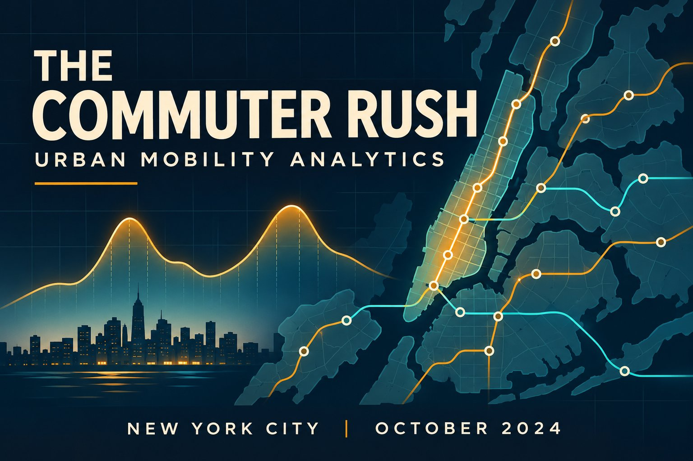
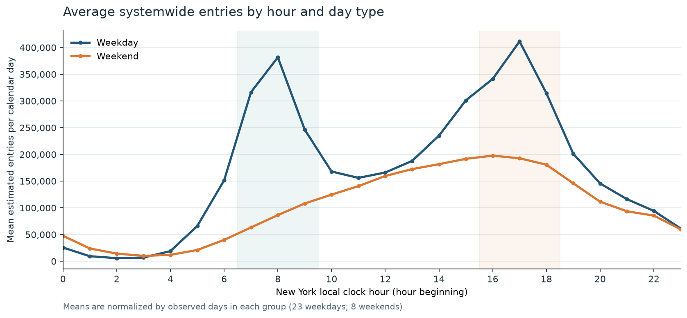
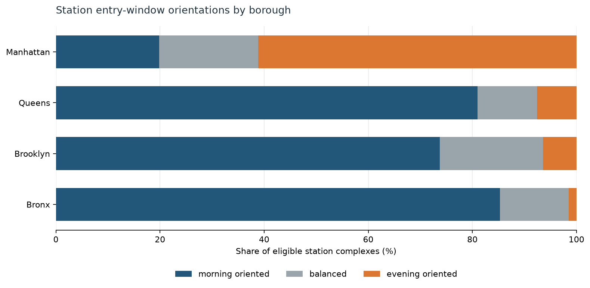
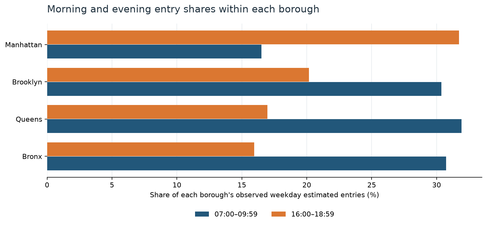
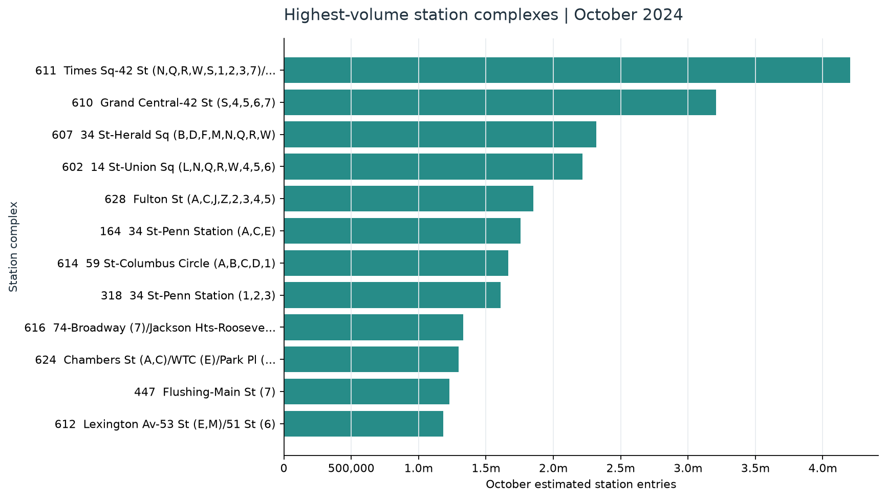
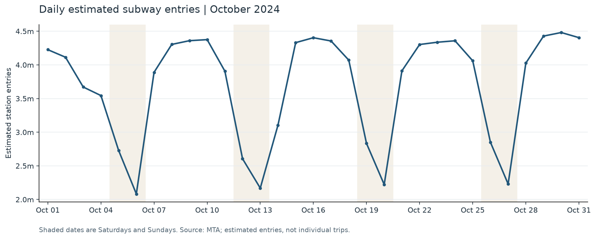

# The Commuter Rush — Urban Mobility Analytics



- **Author:** Cyril James Lunzaga
- **Study:** New York City subway station-complex entry patterns, October 2024
- **Source:** [Metropolitan Transportation Authority (MTA), *MTA Subway Hourly Ridership: 2020–2024*](https://data.ny.gov/d/wujg-7c2s) (`wujg-7c2s`)

> **The central contrast:** Systemwide weekday evening entries exceed morning entries, yet **261 of 424 station complexes are morning-oriented** under the predefined station-level classification. High-volume complexes and borough differences matter when interpreting the system aggregate.

*Cover artwork is illustrative, not a geographically accurate transit diagram or an official MTA map.*

## At a glance

| Verified October 2024 observation | Value |
|---|---:|
| Estimated subway station entries | **114,680,137** |
| Station-hour observations | **310,187** |
| Station complexes | **424** |
| Local calendar days and observed clock hours | **31 days / 744 hours** |
| Source fare-category records reconciled | **2,466,181** |
| Station-hours with documented coordinate variants | **10,508** |

**These are estimated entries, not unique riders or complete journeys.** The source's `transfers` variable is already a subset of `ridership`; its 4,484,500 recorded transfers are **not added** to the entry total.

## Questions and analytical approach

The study asks how estimated station entries change across clock hours and days, how morning and evening entry shares differ by borough, how entries are concentrated at high-volume complexes, and whether individual station profiles tell the same story as system totals.

I used one station-complex × New York local hour as the analytical unit, after source-side fare-category aggregation and reconciliation against independent daily MTA totals. Weekday/weekend comparisons use mean *daily* entries, rather than raw monthly totals, because October contains **23 weekdays and eight weekend days**. The predefined windows are **07:00–09:59** (morning) and **16:00–18:59** (evening); both are three hours long. No absent station-hour was converted into a zero-ridership observation.

For uncertainty, the study resamples **calendar dates**, not individual station-hours: 10,000 fixed-seed (`202410`) percentile bootstrap replications. Intervals describe within-month variation under resampling assumptions; they do not prove a causal effect or extrapolate to other months. Station orientation is a documented balance-index rule with threshold **±0.15**, subject to at least **90% observed coverage in both peak windows**. It is not inferred travel direction or a machine-learned cluster.

## Findings

### 1. The system peaks later, while most station profiles lean earlier

- Weekday entries in the three-hour windows: **22.88% morning** versus **25.84% evening**, calculated as shares of all observed weekday entries.
- Across 23 weekdays, the **mean within-day evening-minus-morning difference is +3.08 percentage points** (within-month 95% bootstrap interval **+2.44 to +3.84 pp**). This daily mean and the aggregate shares use different weighting, so their differences need not be identical.
- The highest mean weekday systemwide entry hour begins at **17:00** (5 p.m.) local time.
- Station orientation: **261 morning-oriented**, **91 evening-oriented**, **72 balanced**. Under alternative four-hour peak windows, **377 of 424 (88.92%)** retain their category; **47 change**.





### 2. Geography and station size explain the aggregate contrast

Manhattan accounts for **56.39%** of observed October estimated subway entries. Its weekday morning and evening shares are **16.50%** and **31.72%**, respectively, whereas Brooklyn, Queens, and the Bronx lean toward morning entries. In a paired day-level comparison, Manhattan's evening-minus-morning entry-share difference exceeds the pooled other boroughs by an average **27.61 percentage points**. These are entry-location patterns, **not origin–destination flows**.

The ten highest-volume complexes account for **18.71%** of entries. Across complexes, the observed entry-total **Gini coefficient is 0.540**, indicating material concentration without assigning any causal mechanism.





### 3. The weekday-heavy result is stable to one date exclusion

Mean daily estimated entries are **4.13 million on weekdays** and **2.47 million on weekends**; the observed weekday/weekend ratio is **1.675×** (within-month bootstrap interval **1.536–1.833**).

October 14 is the lowest-entry weekday in this month. Dropping that date **only for a sensitivity check**, not from the primary dataset, changes the ratio from **1.6749× to 1.6938×**, and the mean evening-minus-morning difference from **+3.0799 to +2.8585 pp**. The direction persists for **22 of 22** retained weekdays. No explanation for the date's low total is inferred.



See the [descriptive findings](portfolio/reports/october_descriptive_findings.md), [statistical evidence](portfolio/reports/october_statistical_evidence.md), and [date sensitivity](portfolio/reports/october_date_sensitivity.md) reports for definitions and full results. All 18 curated CSV tables are in [`portfolio/tables`](portfolio/tables), with nine reviewed PNG figures in [`portfolio/figures`](portfolio/figures).

## Data provenance and quality

**Official source:** [MTA Subway Hourly Ridership: 2020–2024](https://data.ny.gov/d/wujg-7c2s), published through New York State Open Data, provided by the Metropolitan Transportation Authority. Data were requested for local timestamps **2024-10-01 00:00 inclusive to 2024-11-01 00:00 exclusive**, and `transit_mode='subway'`. The dataset's catalog currently lists its **license as unspecified**; no license is inferred for the source data. The repository distributes code, reviewed summary tables, reports, and charts, **not raw downloaded records or the 25.8 MB processed CSV**. Consult the [MTA data page](https://www.mta.info/open-data) and the [dataset catalog](https://data.ny.gov/d/wujg-7c2s) before redistributing underlying extracts.

The reproducible pipeline checks the five quality dimensions:

- **Completeness:** All 31 calendar dates and 744 local clock hours observed; individual station-hour coverage still varies (387–424 stations per systemwide hour). Missing does not mean zero.
- **Accuracy and validity:** Timestamp bounds, nonnegative finite entry values, included transfers, expected columns, and geographic coordinate bounds validated.
- **Consistency:** Repeated coordinate metadata within the same station-hour is **resolved without dropping counts**, and each original variant is retained in an ignored audit snapshot. Exactly **10,508** station-hours contained coordinate variants.
- **Integrity:** Unique station-complex/hour keys, independent Socrata daily totals, source fare-record reconciliation, 31 snapshot hashes, and the processed CSV fingerprint were verified.
- **Validation:** Unit tests, source contract checks, selected one-hour canary and full-day canary, end-to-end daily download reconciliation, and independently cross-checked analytical summaries.

The verified processed CSV SHA-256 for this October analysis is:

`0f74ac842c268e9599485caca1b78c897867140fb976b9fa4e0b1d21b51945eb`

A new API extraction may differ if the data provider revises historical records. See [`docs/data_provenance.md`](docs/data_provenance.md), [`docs/monthly_quality_protocol.md`](docs/monthly_quality_protocol.md), and [`docs/statistical_evidence_protocol.md`](docs/statistical_evidence_protocol.md).

## Run locally with VS Code and PowerShell

Use **Python 3.14.10** (the verified project environment; a compatible Python with suitable pandas/Matplotlib versions may also work). From the repository root:

```powershell
py -3.14 -m venv .venv
$python = ".\.venv\Scripts\python.exe"
& $python -m pip install -r requirements.txt
& $python -m unittest discover -s tests -p "test_*.py" -q
```

The public repository intentionally does **not** contain the downloaded source data. Reproduce the complete October dataset using the official API and then generate the research artifacts:

```powershell
& $python -m commuter_rush.source_probe
& $python -m commuter_rush.monthly_acquisition --mode canary
& $python -m commuter_rush.monthly_acquisition --mode month
& $python -m commuter_rush.temporal_analysis
& $python -m commuter_rush.temporal_visuals
& $python -m commuter_rush.statistical_evidence
& $python -m commuter_rush.station_behaviors
& $python -m commuter_rush.evidence_figures
& $python -m commuter_rush.release_sensitivity
& $python -m commuter_rush.notebook_check
& $python -m commuter_rush.release_audit
```

API extraction can be subject to rate limits and upstream changes. The 31-day downloader validates previously saved snapshots and can resume without discarding successful days. **Do not add `transfers` to estimated entries.** If source metadata or fingerprints differ, investigate before trusting recreated tables and figures. Existing archival review ZIPs may prevent `verify_evidence` from recreating the same ZIP; the non-overwriting release audit is intended for repeatable checks.

The research narrative notebook is [`notebooks/commuter_rush_case_study.ipynb`](notebooks/commuter_rush_case_study.ipynb). The terminal `notebook_check` executes its code cells against locally verified data, while interactive display in VS Code may additionally require `ipykernel` (`& $python -m pip install ipykernel`). The notebook itself contains no embedded machine-specific results.

For a concise rerun of descriptive analysis after data acquisition, `& $python analysis.py` is also supported. See [reproduction notes](docs/phase05_reproducibility.md) for the full execution order and artifact-specific precautions.

## Limitations and conclusions

One month cannot establish annual seasonality or changing trends. Daily bootstrap replications do not fully capture temporal serial dependence or unobserved service/weather/holiday effects. Coverage is incomplete for some station-hours; station-complex coordinates are representative for analytical presentation rather than verified platform positions. The MTA data describe **estimated fare-media entries**, not precise boardings, unique daily customers, crowding, exits, commute purpose, service quality, direction of travel, or causal effects.

**Conclusion:** Observed station entry demand is not uniform. Manhattan and the largest complexes contribute heavily to a systemwide evening-weighted profile, even while most station-level classifications lean toward morning entries. This distinction is operationally useful for describing where and when entries are recorded, but does not by itself prescribe service changes.

**Author:** Cyril James Lunzaga

**Data credit:** Metropolitan Transportation Authority, via New York State Open Data. This is an independent analytical study, not an official MTA publication.
